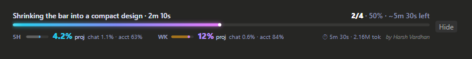

# task-progress



A live progress bar for Claude Code. It sits above the message box and shows:

- the current step and how many steps are done (`2/5 · 40%`)
- **how much of your 5-hour and weekly plan limits this project has used** (big), with this chat's share
  and the account's total next to it, and when each limit resets
- ⏱ elapsed time and an estimate of the time left, and 🪙 tokens used for the current request (small)

The limit figures need a Claude subscription (Pro / Max); with an API key the bar just leaves them out.
Claude only reports the whole account's % used, so a project's share is worked out from how much that %
rises while the project's chats are working. Two chats running at the same moment can credit each other a
little, so treat the per-project and per-chat numbers as close estimates.

It appears for every request, updates as Claude works, and resets when a new job starts.
On the desktop app it is a glowing gradient bar; in the terminal it is a segmented colour bar.

## Install

### From GitHub (recommended)

In a Claude Code terminal session:

```
/plugin install task-progress --marketplace harshvardhanart/claude-progress-bar
```

Answer `y` to add the marketplace and pick the **user** scope so it works in every project.

### From this folder (zip)

1. Unzip it somewhere permanent, for example `C:\Users\<you>\.claude\local-plugins\task-progress`.
2. In a terminal, run:

```
claude plugin marketplace add "C:\Users\<you>\.claude\local-plugins\task-progress"
claude plugin install task-progress@harsh-mods --scope user
```

3. Restart Claude Code, or type `/reload-plugins` in an open chat.

## Use

- The bar shows up by itself when you send a message.
- **Hide** hides it; `/progress` brings it back; `/progress hide` hides it again.

## Requirements

A Claude Code build with plugin function hooks (the engine that runs `hooks/register.tsx`).

Made by **Harsh Vardhan**.
